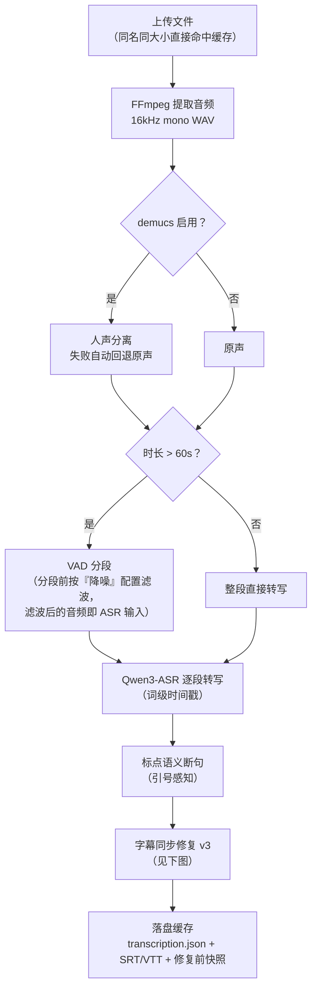
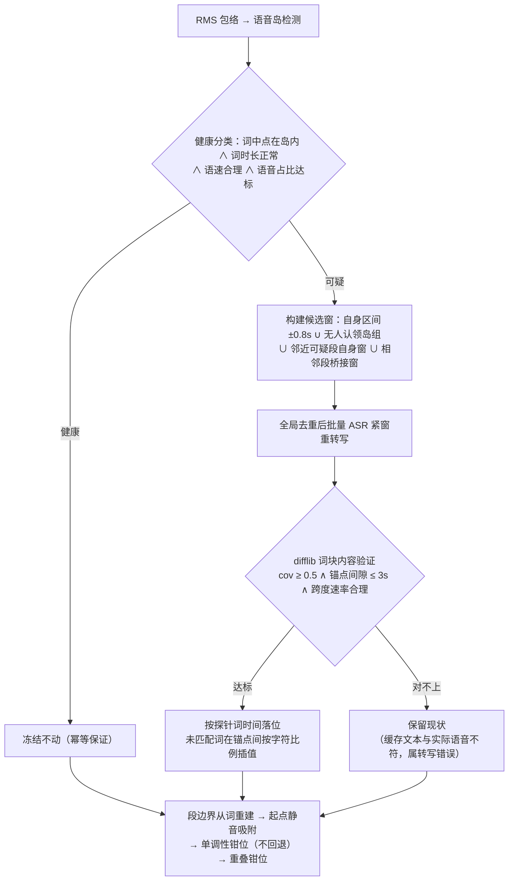
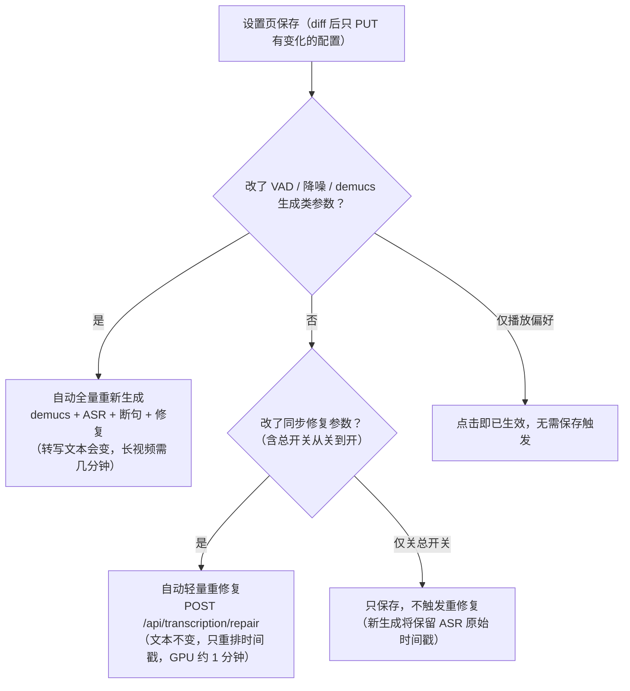

# ASR Server - English Speaking Practice Web Application

基于 Qwen3-ASR 的英语口语练习 Web 应用

## 功能特性

- 🎤 **音视频上传** - 支持视频和音频文件
- 📝 **AI字幕生成** - 使用 Qwen3-ASR 生成高质量字幕
- 🎚️ **人声分离** - 集成 demucs，带背景音乐的视频先分离人声再识别，字幕更准确；播放时可切换人声/原声音轨，波形与单句下载跟随音源
- ⏱️ **时间轴对齐** - 单词级时间戳，支持精确同步
- 🔧 **字幕同步修复** - 自动校对字幕与语音的对齐（错位/挤扁/漂移），参数可在设置页运行时调整，修改后轻量重修复（不重新转写）
- 🎯 **跟读练习** - 录音并评估发音准确度
- 📊 **详细分析** - 单词级对比和评分反馈
- ⌨️ **快捷键支持** - 高效的键盘操作
- 🌙 **深色模式** - 护眼的深色主题

## 技术栈

### 后端
- **框架**: FastAPI + Python
- **AI模型**: Qwen3-ASR-1.7B + Qwen3ForcedAligner-0.6B
- **人声分离**: demucs（可选）
- **音频处理**: FFmpeg, soundfile
- **架构**: 分层架构 (API → Service → Core)

### 前端
- **框架**: React 18 + Vite
- **状态管理**: Redux Toolkit
- **样式**: TailwindCSS
- **图标**: Lucide React

## 快速开始

### 前置要求

1. **Python 3.10+**（建议用 conda 管理环境）
2. **Node.js 18+**
3. **FFmpeg** (必须安装并在 PATH 中)
   - Windows: [下载](https://ffmpeg.org/download.html)
   - Linux: `sudo apt install ffmpeg`
   - Mac: `brew install ffmpeg`
4. **CUDA** (可选，GPU 加速)
5. **模型文件** - 下载以下模型到 `models/` 目录:
   - Qwen3-ASR-1.7B (或 0.6B)
   - Qwen3-ForcedAligner-0.6B

### 安装步骤

```bash
# 1. 创建 conda 环境（注意：start.bat 固定使用名为 qwen3-asr 的环境）
conda create -n qwen3-asr python=3.10
conda activate qwen3-asr

# 2. 安装后端依赖
cd backend
pip install -r requirements.txt

# 3. (可选) 安装 demucs 启用人声分离
pip install demucs
# 下载 htdemucs 模型到本地目录（用于离线加载），例如：
#   D:\adefossez\HTDemucs   （htdemucs.yaml + 955717e8.th 等）
# 不下载也可以，首次分离时 demucs 会自动联网从 HuggingFace 下载

# 4. 安装前端依赖
cd ../frontend
npm install
```

### 一键启动

#### Windows
```batch
start.bat
```

#### Linux/Mac
```bash
chmod +x start.sh
./start.sh
```

脚本会自动:
1. 检查环境
2. 安装依赖
3. 启动后端服务器 (http://localhost:8000)
4. 启动前端服务器 (http://localhost:5173)

> Windows 版 start.bat 固定激活名为 `qwen3-asr` 的 conda 环境，如环境名不同请修改脚本。

### 手动启动

#### 后端
```bash
conda activate qwen3-asr
cd backend
pip install -r requirements.txt
python -m app.main
```

#### 前端
```bash
cd frontend
npm install
npm run dev
```

## 开发与构建

### 日常开发不需要 build

- **后端**: `python -m app.main` / `uvicorn` 以 `reload=True` 启动，修改 `.py` 文件后**自动重载**，无需重启
- **前端**: `npm run dev` 启动 Vite 开发服务器，改动**热更新**（改 Redux store / 全局状态相关文件后建议 F5 刷新一次浏览器，热更新对 store 类模块不一定彻底）

### 什么时候需要 build

只有两种场合需要构建前端：

1. **部署/发布**：把应用给别人用、脱离 Vite 开发服务器运行时
2. **验证发布产物**：确认构建结果正常

### 怎么 build

```bash
cd frontend
npm run build        # 产物输出到 frontend/dist/
npm run preview      # 本地预览构建产物 (http://localhost:4173)
```

> **部署注意**：当前后端不托管 `dist/`（没有 StaticFiles 挂载），生产部署需要自行解决两件事：
> 1. 用 Nginx 等静态服务器托管 `dist/`，并把 `/api` 反向代理到后端 8000 端口（前端请求走 `/api` 前缀）
> 2. 后端 CORS 默认只允许 `localhost:5173/3000`（见 `backend/app/main.py`），其他源需在 `main.py` 或通过 `FRONTEND_URL` 环境变量添加
>
> 媒体文件（视频/音频）请求直连 `http://localhost:8000`（见 `frontend/src/services/mediaService.js` 的 `API_BASE_URL`），部署时需同步调整 `VITE_API_BASE_URL` 环境变量。

### 其他有用命令

```bash
cd frontend
npm run lint         # ESLint 检查

cd backend
python -m py_compile app/main.py   # 快速语法检查单个文件
```

## 使用指南

### 1. 上传文件
- 点击顶部导航栏的 "打开文件" 按钮（或直接拖拽文件到播放器区域）
- 选择视频或音频文件，上传后自动生成字幕
- 同名同大小的文件再次上传会直接命中缓存，不重复识别

### 2. 生成字幕
- 右侧面板显示字幕列表
- 点击字幕跳转到对应时间并单句播放

### 3. 播放与练习
- 使用播放器控制条播放视频
- 选择字幕后可在下方练习区进行跟读
- 点击"打开独立窗口"可把播放器弹出为独立窗口（与主窗口状态同步）

### 4. 快捷键

| 快捷键 | 功能 |
|--------|------|
| `Space` | 播放/暂停 |
| `A` | 上一句 |
| `D` | 下一句 |
| `R` | 重播当前句 |
| `S` | 切换单句循环 |
| `L` | 按住录音 |
| `1-4` | 切换倍速 (0.5x - 1.25x) |
| `Esc` | 关闭弹窗 |
| `?` | 显示快捷键帮助 |

## 处理流水线

### 1. 字幕生成（上传后自动触发）



**各环节的后果**（改了什么会影响什么）：

| 环节 | 改动后果 |
|------|----------|
| demucs 开关/模型 | **改变 ASR 输入音频** → 转写文本会变，需全量重新生成；播放音轨跟随 |
| VAD 参数 | 改变分段边界 → 影响断句粒度与转写文本，需全量重新生成 |
| 降噪（滤波器类型/截止频率） | 长音频（>60s）滤波后的音频就是 ASR 输入 → 影响转写文本；短音频只影响降噪对比副本；需全量重新生成 |
| 转写语言 | 改变识别语言 → 需全量重新生成 |
| 同步修复参数 | **只改时间戳排列，不改文本** → 轻量重修复即可（见下图） |

### 2. 字幕同步修复 v3（`_refine_segment_timing`，机制详见 `backend/README_sync_repair.md`）

ASR 内置对齐器在长窗口上会把时间戳压缩/漂移（错位、挤扁、钉死在静音上）。修复通道用"紧窗重转写 + 内容验证"重新锚定：



**后果**：
- 时间戳本来就对的字幕段（健康段）**绝不会被重排**——这是重跑幂等的基础
- 修复只用缓存里已有的人声音频做局部重听，**不改字幕文本**，不重跑 demucs/ASR
- 修复前的原始时间戳保存在 `transcription.presnap.json`，可事后区分"ASR 本来就错"还是"修复推翻了正确时间"
- 误判时可调小"候选窗搜索半径"，或关闭总开关回滚到 ASR 原始时间戳

### 3. 设置页修改后的生效路径

设置页为选项卡结构（**麦克风 / 降噪 / 人声分离 / 字幕质量**），底部全局保存只提交有改动的配置，有未保存修改的选项卡标题带 ● 脏标记：



> 手动批量重修复旧缓存：`python backend/repair_cache.py [cache_dir ...]`（无参数 = 全部缓存）。

## 人声分离 (demucs)

对带背景音乐/噪音的视频，可在识别前用 [demucs](https://github.com/adefossez/demucs) 把人声分离出来，只对干净人声做 ASR，显著减少背景音乐造成的幻听和错字。

### 启用条件

- 后端所在 Python 环境已安装 demucs：`pip install demucs`
- 模型可用：在设置中填写**本地模型仓库路径**（如 `D:\adefossez\HTDemucs`，离线加载）；留空则首次分离时自动联网从 HuggingFace 下载
- 服务启动日志会输出 demucs 检测结果；`GET /api/system/status` 的 `demucs_available` 字段标识可用性

### 两个独立设置（设置页 → 人声分离选项卡）

| 设置 | 行为 |
|------|------|
| **生成字幕时启用人声分离** | 影响识别结果。修改后点"保存"会**自动重新生成**当前视频的字幕 |
| **播放时使用人声音轨** | 纯播放偏好，**点击立即生效**，不触发字幕重新生成。仅对已用人声分离生成过字幕的视频生效（视频原声被静音，叠加播放人声轨） |

未检测到 demucs 时两个开关显示但禁用，并提示安装方法。

### 顶栏快捷开关

demucs 可用时，顶栏（深色模式切换按钮左侧）显示人声音轨快捷开关（声波图标）：高亮 = 播放人声，普通 = 播放原声，悬停有说明。点击立即生效并持久化，与设置页开关双向同步；独立弹窗播放器也会实时跟随。

### 跟随播放音源的功能

以下功能跟随"播放时使用人声音轨"开关（当前视频无人声文件时自动回退原声）：

- **播放器声音**：人声模式下视频原声静音，叠加播放分离人声轨；播放/暂停/拖进度/倍速/单句循环全同步
- **跟读练习波形**：振幅与音高曲线改用人声计算，音高参照不受背景音乐污染（切换音源时波形自动刷新）
- **单句音频下载**：字幕列表当前播放句三角形左侧的下载按钮，输出 MP3（文件名即句文本）

### 行为细节

- **缓存复用**：分离出的人声（`temp/{file_id}_vocals.wav`）按文件缓存，同一视频反复生成不重复分离；更换模型名/仓库路径后自动重新分离
- **输入先提取 wav**：demucs 不直接吃 mkv/mp4 原始容器——它自带的容器解码器在长视频上会丢样本，导致人声轨内容相对原片时间轴漂移（90 分钟电影实测中段偏移数十秒且持续累积，短视频几乎无感），字幕和播放都会对不上。服务端与 `split_movie.py` 均先提取 16kHz mono wav 再分离
- **失败回退**：分离失败（显存不足、模型缺失、超时等）自动回退用原声继续生成字幕，日志记录 warning，字幕生成不会失败
- **耗时**：GPU 上约为音频时长的 1/40 ~ 1/70（30 分钟视频约 30-60 秒）；生成请求超时已放宽到 30 分钟
- **时间轴不变**：分离不改变时间轴，字幕与视频原声/人声播放均保持同步
- GPU 显存：demucs 子进程约 3-4GB，与常驻的 ASR 模型顺序执行不并发；低端卡 OOM 会触发回退

## 电影切分工具 (split_movie.py)

把长电影按句子边界切成 5~8 分钟的练习小段，每段附带平移过时间轴的 SRT 字幕。

```bash
conda activate qwen3-asr
python split_movie.py D:\Movies\某电影.mkv
```

输出到电影同目录下以电影名命名的文件夹（`01_part1.mp4` / `01_part1.srt` / ...），无需启动服务器，但依赖项目模块与模型。

### 参数

| 参数 | 默认 | 说明 |
|------|------|------|
| `--min` / `--max` | 5 / 8 分钟 | 每段时长范围，装箱尽量贴近 max，超了就在下一句前切 |
| `--language` | auto | 转写语言（auto / English / Chinese） |
| `--no-demucs` | — | 跳过 demucs 人声分离（默认开启，电影背景音乐多） |
| `--copy` | — | 流拷贝切割（快但切点吸附关键帧，不精确，不推荐） |
| `--force` | — | 忽略转写缓存重新识别 |

### 行为要点

- **切点保证在句子之间**：整体 STT（VAD + 词级时间戳）→ 标点语意断句 → 贪心装箱，超上限就在下一句开始前切
- **对齐保障**：demucs 分离前先用 ffmpeg 提取 wav，**不把 mkv/mp4 原始容器直接交给 demucs**——它自带的容器解码器在长视频上会丢样本，人声轨时间轴漂移（90 分钟电影实测偏移数十秒且随时间累积，短视频几乎无感），字幕就会和视频对不上（见"人声分离"章节）
- **转写缓存**：结果存输出目录 `asr_result.json`（顶层字段多行缩进、timestamps 压成单行），中断重跑跳过识别；**改 min/max 重切前需删除旧的 `0X_partX.mp4`**
- **切割精度**：重编码到 h264（NVENC 真实探测，不可用自动回退 libx264；ffmpeg 9.0 的 nvenc 需要 NVIDIA 驱动 610.00+）；`-c copy` 会吸附关键帧所以默认不用
- **中间产物即用即删**：只保留成品与 `parts.json` 切割清单

## API 文档

启动后端后访问: http://localhost:8000/docs

### 主要端点

#### 媒体管理
- `POST /api/media/upload` - 上传文件
- `GET /api/media/file/{file_id}` - 获取文件
- `GET /api/media/audio/{file_id}` - 获取提取的音频 (16kHz mono WAV)
- `GET /api/media/vocals/{file_id}` - 获取分离的人声音频（无人声时 404）
- `GET /api/media/sentence/{file_id}?start&end&use_vocals&name` - 下载单句音频片段 (MP3)
- `GET /api/media/waveform/{file_id}` - 波形数据（`use_vocals=true` 时用人声计算）
- `DELETE /api/media/file/{file_id}` - 删除文件（含清理对应音频/人声缓存）

> 所有媒体流式端点（file/audio/vocals）支持 Range 请求（206 Partial Content），浏览器 seek 直接定位字节区间，拖动进度与中段起播不再长缓冲。

#### 字幕生成
- `POST /api/transcription/generate` - 生成字幕（响应含 `metadata.used_demucs` 标记）
- `POST /api/transcription/repair/{file_id}` - 轻量重跑同步修复（只重排时间戳，不重跑 demucs/ASR，分钟级）
- `GET /api/transcription/subtitles/{file_id}` - 获取字幕
- `GET /api/transcription/cache/check/{file_id}` - 检查缓存状态
- `GET /api/transcription/cache/load/{file_id}` - 加载缓存字幕
- `GET /api/transcription/export/{file_id}` - 导出字幕 (SRT/VTT)

#### 练习评估
- `POST /api/practice/evaluate` - 评估发音
- `GET /api/practice/health` - 健康检查

#### 系统状态
- `GET /api/system/status` - 系统状态（含 `demucs_available`）
- `GET /api/system/health` - 健康检查

#### 动态配置
- `GET/PUT /api/vad/config` - VAD 参数（`POST /config/reset` 重置）
- `GET/PUT /api/noise/config` - 音视频降噪参数
- `GET/PUT /api/demucs/config` - 人声分离配置（含 `demucs_available`）
- `GET/PUT /api/sync-repair/config` - 字幕同步修复参数（总开关 + 阈值）

## 配置

### 环境变量

创建 `.env` 文件在 `backend/` 目录:

```bash
# 模型配置
ASR_MODEL_SIZE=1.7B          # 可选: 0.6B 或 1.7B

# 设备配置
USE_CPU=false                 # true 使用 CPU

# 模型精度
DTYPE=bfloat16               # bfloat16, float16, float32

# 服务配置
HOST=127.0.0.1
PORT=8000

# 文件上传
MAX_UPLOAD_SIZE=524288000    # 500MB
```

### 动态配置文件（设置页修改，自动持久化）

以下配置在设置页修改后立即生效并写入 JSON 文件；**手动编辑文件需要重启后端**（启动时加载进内存）：

| 文件 | 内容 | 对应设置页位置 |
|------|------|----------------|
| `backend/vad_config.json` | VAD 切分参数 | 字幕质量 → VAD 参数 |
| `backend/noise_config.json` | 音视频降噪（Butterworth 滤波）参数 | 降噪 |
| `backend/demucs_config.json` | 人声分离：`enabled` / `model_name` / `repo_path` / `playback_use_vocals` | 人声分离 |
| `backend/sync_repair_config.json` | 字幕同步修复参数（env `SYNC_REPAIR_*` 仅作首次种子） | 字幕质量 → 字幕同步修复 |

> 麦克风降噪是纯前端本地配置（localStorage），与上述服务端配置互不影响。

### 前端配置

编辑 `frontend/vite.config.js` 修改端口和代理设置。

### 数据目录

| 目录 | 内容 |
|------|------|
| `uploads/` | 上传的原始文件（`{uuid}.{ext}`），删除文件时自动清理 |
| `temp/` | 处理中间产物：`{file_id}.wav` 提取音频、`{file_id}_vocals.wav` 分离人声（复用缓存） |
| `cache/` | 识别结果缓存 `cache/{文件名}_{文件大小}/`，含字幕 JSON/SRT/VTT 与音频；改名或改大小视为新文件 |

## 项目结构

```
D:\ASR_Server/
├── backend/                 # 后端
│   ├── app/
│   │   ├── api/            # API 路由（media/transcription/practice/system/vad/noise/demucs/sync_repair）
│   │   ├── services/       # 业务逻辑（字幕生成、同步修复、媒体处理、缓存、VAD）
│   │   ├── models/         # 数据模型（domain + schemas）
│   │   ├── utils/          # 工具函数（ffmpeg 封装、demucs 封装、音频处理、语音岛检测）
│   │   └── core/           # 模型加载与动态配置管理（*_config.py）
│   ├── repair_cache.py     # 对已有缓存批量重跑同步修复（CLI，见"处理流水线"）
│   ├── probe_sync_truth.py # 字幕错位诊断探针（紧窗重转写真值夹具）
│   ├── test_sync_repair.py / test_punct_segmentation.py   # 离线验收测试
│   ├── README_sync_repair.md   # 同步修复机制详解（v1~v3 迭代与教训）
│   ├── requirements.txt
│   └── *_config.json       # 动态配置（设置页修改，运行时持久化）
├── frontend/               # 前端
│   ├── src/
│   │   ├── components/     # React 组件（player/settings/subtitle/practice）
│   │   ├── store/          # Redux 状态（ui/media/player/subtitle/practice）
│   │   ├── services/       # API 服务
│   │   ├── hooks/          # 自定义 Hooks（播放同步、独立窗口、快捷键）
│   │   └── utils/          # 工具函数
│   ├── package.json
│   └── vite.config.js
├── models/                 # 模型文件（Qwen3-ASR / ForcedAligner）
├── split_movie.py         # 电影按句子边界切分工具（见"电影切分工具"章节）
├── uploads/                # 上传文件
├── temp/                   # 处理中间产物（提取音频/分离人声）
├── cache/                  # 识别结果缓存（含 transcription.presnap.json 修复前快照）
├── start.bat              # Windows 启动脚本
├── start.sh               # Linux/Mac 启动脚本
└── README.md              # 本文件
```

## 故障排除

### FFmpeg 未找到
- 确保 FFmpeg 在 PATH 中
- 测试: `ffmpeg -version`

### demucs 未检测到（设置页开关禁用）
- 在后端运行的那个 conda 环境里安装：`conda activate qwen3-asr && pip install demucs`
- 装完后重启后端（可用性检测结果进程内缓存）

### 人声分离失败 / 字幕回退原声
- 查看后端日志中的 warning（含 demucs 子进程 stderr）
- 检查设置里的**模型仓库路径**是否存在（如 `D:\adefossez\HTDemucs`）
- 检查模型名是否正确（默认 `htdemucs`）
- 显存不足时 demucs 会被 OOM 杀掉并回退，可换小显存时段使用或接受原声结果

### 打开了"播放时使用人声音轨"但还是原声
- 该视频的字幕必须是**启用人声分离后生成**的（响应 metadata 里 `used_demucs: true`）
- 旧视频需重新生成：启用"生成字幕时启用人声分离"后，在设置页（人声分离选项卡）点"保存"，即可强制重跑
- 前端页面刷新一次（F5）确保代码和状态最新

### CUDA 内存不足
- 使用小模型 (0.6B)
- 设置 `USE_CPU=true`
- 减小批次大小

### 模型加载失败
- 检查模型路径是否正确
- 确保模型文件完整
- 检查磁盘空间 (约 10GB)

### 前端无法连接后端
- 检查后端是否启动 (http://localhost:8000/health)
- 检查 CORS 配置
- 查看浏览器控制台错误

### 改了代码没生效
- 后端：uvicorn `reload=True` 会自动重载，确认后端窗口没有报错退出
- 前端：Vite 热更新，改 Redux store 相关文件后 F5 刷新浏览器

## 开发

### 后端开发
```bash
conda activate qwen3-asr
cd backend
pip install -r requirements.txt
uvicorn app.main:app --reload --port 8000
```

### 前端开发
```bash
cd frontend
npm install
npm run dev
```

### 添加新功能
1. 后端: 在 `app/api/` 添加路由，在 `app/api/__init__.py` 注册
2. 前端: 在 `src/services/` 添加 API 调用
3. 状态: 在 `src/store/` 添加 slice
4. 动态配置项: 参考 `app/core/noise_config.py`（dataclass + 单例 Manager + JSON 持久化）和 `app/api/noise_config.py`

## 许可证

MIT License

## 贡献

欢迎提交 Issue 和 Pull Request!

## 致谢

- [Qwen Team](https://github.com/QwenLM/Qwen2-Audio) - Qwen3-ASR 模型
- [adefossez](https://github.com/adefossez/demucs) - demucs 人声分离
- [FastAPI](https://fastapi.tiangolo.com/) - 现代 Web 框架
- [React](https://react.dev/) - UI 框架
- [TailwindCSS](https://tailwindcss.com/) - CSS 框架

---

**Made with ❤️ for English learners**
